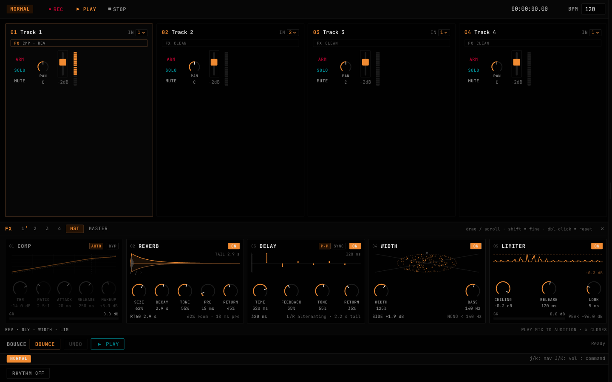

# Tracker — Multitrack Recorder

A minimal multitrack audio recorder for the desktop. No timeline, no grid — just arm, level, record, listen.

Built with **Tauri** (Rust + React/TypeScript) with a keyboard-first, Vim-native interface inspired by the Zoom R4 MultiTrak.



## Features

- **4-track recording** with 32-bit float WAV output
- **Keyboard-first** — Vim keybindings: `j`/`k` navigation, `J`/`K` volume, `1`-`4` arm, `Space` play, `R` record
- **Dedicated bounce track** — mix tracks down to free up space for overdubs
- **Live level metering** — real-time RMS/peak display from any ALSA/PipeWire input device
- **Per-track controls** — arm, solo, mute, pan, volume fader, and a native effects chain
- **Native effects** — 3-band EQ and compressor per track, shared reverb/delay sends, master widener and lookahead limiter
- **Audio playback** — audition the full mix through the effects rack, or bounce to a stereo WAV
- **Command palette** — Vim-style `:` mode for actions without dedicated bindings
- **Dark instrument-panel aesthetic** — amber signal glow, near-black interface, mono-forward typography

## Quick Start

```bash
# Prerequisites: Rust toolchain + Node.js 18+
npm install

# UI-only development (fast iteration, no audio backend)
npm run dev

# Full desktop app with audio engine
npm run tauri dev
```

### Device Setup (Linux/PipeWire)

1. Run `npm run tauri dev`
2. Hover the right edge of the window → sidebar slides out
3. Select your audio input device from the **Device** dropdown
4. Click **● CAPTURE** — Track 1's meter shows live input
5. Arm a track (press `1`), then press `R` to record
6. Press `Space` to stop, then click **▶ PLAY** to hear the mix

### Effects

Press `x` (or click `FX` on a track) to open the rack. `[` / `]` cycle between
tracks and the master bus, `Escape` closes it.

- **Track:** EQ → compressor → fader/pan. `REV` and `DLY` send post-fader into
  the shared buses.
- **Master:** compressor → reverb → delay → widener → limiter.
- Every knob: drag, scroll, or focus and use the arrow keys (`Shift` = fine,
  double-click = reset). EQ nodes can be dragged directly on the curve.
- `PLAY` renders the current settings and plays them, so you hear edits without
  bouncing. Gain-reduction meters animate with the render.

All effects are hand-written Rust DSP — no VSTs, no plugin host.

## E2E Tests

```bash
# Browser-only mode (26 tests, ~45s, no Tauri needed)
npm run test:e2e

# Rust DSP + engine tests
cd src-tauri && cargo test --lib

# Full desktop mode (requires tauri dev with e2e-testing, window visible)
npm run test:e2e:tauri
```

## Architecture

```
┌──────────────────────────────────────────────────┐
│  React UI (TypeScript)                           │
│  ─ Track strips, transport, meters               │
│  ─ Command palette, Vim keybindings              │
└────────────────┬────────────────────────────────┘
                 │ Tauri IPC (invoke + events)
                 ▼
┌──────────────────────────────────────────────────┐
│  Rust Backend (Tauri + cpal + ringbuf)           │
│  ─ Real-time audio capture via cpal 0.18         │
│  ─ Lock-free ring buffers for sample transfer    │
│  ─ 32-bit float WAV recording via hound          │
│  ─ Per-sample level computation (RMS/peak)       │
│  ─ Bounce track mixdown                          │
└──────────────────────────────────────────────────┘
```

## Tech Stack

- **Desktop framework**: [Tauri v2](https://v2.tauri.app/)
- **Frontend**: React 18 + TypeScript + Vite
- **Audio**: [cpal 0.18](https://github.com/RustAudio/cpal) (Linux ALSA/PipeWire backend)
- **Lock-free buffers**: [ringbuf](https://github.com/agerasev/ringbuf)
- **WAV**: [hound](https://github.com/ruuda/hound)
- **E2E testing**: [Playwright](https://playwright.dev/) + [tauri-playwright](https://github.com/srsholmes/tauri-playwright)
- **Audio backend**: real-time safe, SCHED_FIFO priority, no allocations in audio callback

## Design

See [PRODUCT.md](./PRODUCT.md) and [DESIGN.md](./DESIGN.md) for the full product strategy and visual design system.

## License

MIT
