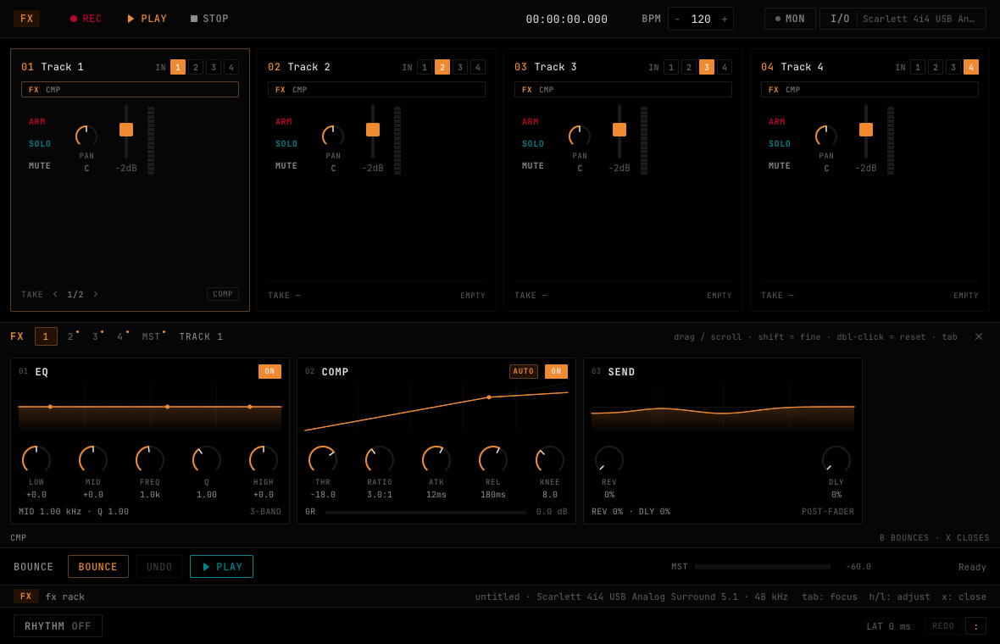

# Tracker — Multitrack Recorder

A minimal multitrack audio recorder for the desktop. No timeline, no grid — just arm, level, record, listen.

Native [Odin](https://odin-lang.org/) application, drawn with the sibling
[vinland-ui](https://github.com/WilsonNet/vinland-ui) toolkit (SDL3 + Vulkan, OpenGL
fallback). Keyboard-first and Vim-native, inspired by the Zoom R4 MultiTrak.



## Features

- **4-track recording** with true mono 32-bit float WAVs and RF64/BW64 support
- **Multi-take recording and comping** — stable take files, active-take cycling, comp regions
- **Overdub** — hear the existing mix while recording the next part
- **Native effects** — 3-band EQ and compressor per track, shared FDN reverb and
  ping-pong delay sends, master compressor, widener and lookahead limiter
- **Bounce** — render the full chain to a stereo float mixdown, with reverb tails
- **Live metering** — peak/RMS per track plus compressor gain reduction
- **Keyboard-first** — Vim navigation, `1`–`4` arm, `Space` play/stop, `R` record,
  `x` FX rack, `,` settings, `:` command palette
- **Project persistence** — atomic `project.json`, recent projects, undo/redo,
  native open/save dialogs
- **Google Drive transfer** — back up a self-contained project and restore it
  on another computer; visible, named Drive folder, `drive.file` scope only,
  no remote delete
- **Settings** — choose the project folder, input backend, latency and
  monitoring, plus high contrast and reduced motion; folder and accessibility
  choices persist in `settings.json`. Text fields have a real caret and
  selection: click/drag/shift-click, double-click a word, triple-click all,
  clipboard and undo, with secrets rendered as `*`
- **HiDPI and responsive density** — crisp type at 1×–3×; the native window uses SDL density and a flexible layout, while the headless harness and `ui-shot` scale the whole virtual frame for larger canvases
- **Linux audio** — PipeWire/ALSA capture and cooperative JACK capture (`--jack`)

## Quick start

The app lives in [`odin/`](odin/). You need Odin `dev-2026-11a` or newer, the
sibling vinland-ui checkout, and the system libraries listed in
[`odin/README.md`](odin/README.md#dependencies).

```sh
# vinland-ui must be checked out next to this repo
git clone https://github.com/WilsonNet/vinland-ui ../vinland-ui

cd odin
make build        # -> bin/tracker-odin
make test         # 265 unit tests
make check        # tests + headless UI tour + offline bounce

./bin/tracker-odin ui              # real window
./bin/tracker-odin ui --demo       # synthetic meters, no audio hardware
```

Sessions default to `$XDG_DATA_HOME/tracker/session` (usually
`~/.local/share/tracker/session`); press `,` and choose a
project folder to change it (persisted in `~/.config/tracker/settings.json`),
or pass `--session DIR` for an isolated run that ignores saved settings.
For Google Drive transfer, follow [docs/cloud-setup.md](docs/cloud-setup.md).
`make install` installs the binary, icons and desktop entry under `~/.local`.

## Verification

```sh
cd odin
make test          # DSP + engine/project/WAV + UI unit tests
make e2e           # 17 headless vinland-ui cases (tests/ui/window.vt)
make check         # unit + 220-action UI tour + offline bounce + format checks
```

`make check` needs `python3`; `ffprobe` and `sox` checks run when installed.
Hardware, loopback and JACK checks: `./scripts/check.sh --hardware --jack --loopback`.

## Layout

```
odin/          the native application (source, DSP, UI, tests, docs)
docs/          product research and design references
PRODUCT.md     product strategy
DESIGN.md      visual design system
```

- [`odin/README.md`](odin/README.md) — build, CLI, make targets, native UI, verification
- [`odin/ROADMAP.md`](odin/ROADMAP.md) — completion record and intentional limits
- [`odin/VERIFICATION.md`](odin/VERIFICATION.md) — test and measurement matrix
- [`docs/RESEARCH.md`](docs/RESEARCH.md) — Zoom R4 MultiTrak analysis
- [`docs/fx-research.md`](docs/fx-research.md) — effects architecture research

## Implementation

Tracker is a single native binary in [`odin/src/`](odin/src): the window is
SDL3 + Vulkan/OpenGL through vinland-ui, audio capture runs through miniaudio or
a cooperative JACK client, and the DSP is plain Odin. There is no webview, no
JavaScript runtime and no IPC boundary.

## License

MIT
